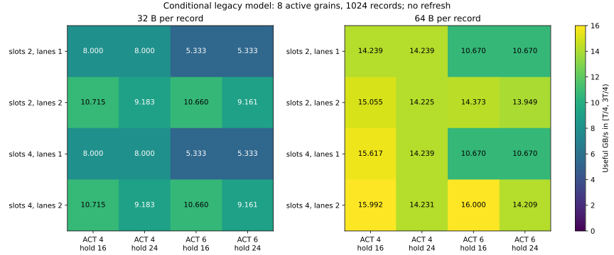

# P2：有界交互与共享范围诊断

本轮完成 56 个确定性运行，每个配置一次。时序契约为 `legacy_0270afa`；不改内部/外部延迟，不加入 A。所有运行先通过测试，再通过独立命令检查器。

中段改为预先声明的完成时间中间一半 `[T/4,3T/4)`；同时间返回一起计入或排除。旧的返回事件序号指标单列，供外部审计复验，不能混称为稳态。

## 1. 32 点交互

| 字节 | ACT ns | 槽位 | hold ns | 行通路 | 完成 ns | 时间中段 GB/s | 旧事件中段 GB/s |
|---:|---:|---:|---:|---:|---:|---:|---:|
| 32 | 4 | 2 | 16 | 1 | 4144 | 8.000 | 8.000 |
| 32 | 4 | 2 | 16 | 2 | 3106 | 10.715 | 10.667 |
| 32 | 4 | 2 | 24 | 1 | 4144 | 8.000 | 8.000 |
| 32 | 4 | 2 | 24 | 2 | 3610 | 9.183 | 9.143 |
| 32 | 4 | 4 | 16 | 1 | 4144 | 8.000 | 8.000 |
| 32 | 4 | 4 | 16 | 2 | 3106 | 10.715 | 10.667 |
| 32 | 4 | 4 | 24 | 1 | 4144 | 8.000 | 8.000 |
| 32 | 4 | 4 | 24 | 2 | 3610 | 9.183 | 9.143 |
| 32 | 6 | 2 | 16 | 1 | 6192 | 5.333 | 5.333 |
| 32 | 6 | 2 | 16 | 2 | 3122 | 10.660 | 10.667 |
| 32 | 6 | 2 | 24 | 1 | 6192 | 5.333 | 5.333 |
| 32 | 6 | 2 | 24 | 2 | 3626 | 9.161 | 9.143 |
| 32 | 6 | 4 | 16 | 1 | 6192 | 5.333 | 5.333 |
| 32 | 6 | 4 | 16 | 2 | 3122 | 10.660 | 10.667 |
| 32 | 6 | 4 | 24 | 1 | 6192 | 5.333 | 5.333 |
| 32 | 6 | 4 | 24 | 2 | 3626 | 9.161 | 9.143 |
| 64 | 4 | 2 | 16 | 1 | 4670 | 14.239 | 14.222 |
| 64 | 4 | 2 | 16 | 2 | 4400 | 15.055 | 15.059 |
| 64 | 4 | 2 | 24 | 1 | 4670 | 14.239 | 14.222 |
| 64 | 4 | 2 | 24 | 2 | 4652 | 14.225 | 14.222 |
| 64 | 4 | 4 | 16 | 1 | 4262 | 15.617 | 15.604 |
| 64 | 4 | 4 | 16 | 2 | 4146 | 15.992 | 16.000 |
| 64 | 4 | 4 | 24 | 1 | 4670 | 14.239 | 14.222 |
| 64 | 4 | 4 | 24 | 2 | 4650 | 14.231 | 14.222 |
| 64 | 6 | 2 | 16 | 1 | 6208 | 10.670 | 10.667 |
| 64 | 6 | 2 | 16 | 2 | 4622 | 14.373 | 14.359 |
| 64 | 6 | 2 | 24 | 1 | 6208 | 10.670 | 10.667 |
| 64 | 6 | 2 | 24 | 2 | 4758 | 13.949 | 13.956 |
| 64 | 6 | 4 | 16 | 1 | 6208 | 10.670 | 10.667 |
| 64 | 6 | 4 | 16 | 2 | 4160 | 16.000 | 16.000 |
| 64 | 6 | 4 | 24 | 1 | 6208 | 10.670 | 10.667 |
| 64 | 6 | 4 | 24 | 2 | 4680 | 14.209 | 14.222 |

## 2. 多命令组压力

| 活动组 | 字节 | 行通路 | 完成 ns | 时间中段 GB/s | 旧事件中段 GB/s | 最大 12 ns 激活数 |
|---:|---:|---:|---:|---:|---:|---:|
| 1 | 32 | 1 | 4144 | 8.000 | 8.000 | 3 |
| 1 | 32 | 2 | 3106 | 10.715 | 10.667 | 6 |
| 1 | 64 | 1 | 4262 | 15.617 | 15.604 | 3 |
| 1 | 64 | 2 | 4146 | 15.992 | 16.000 | 6 |
| 4 | 32 | 1 | 1072 | 32.000 | 32.000 | 12 |
| 4 | 32 | 2 | 802 | 43.411 | 42.667 | 24 |
| 4 | 64 | 1 | 1114 | 62.276 | 62.534 | 12 |
| 4 | 64 | 2 | 1074 | 63.881 | 64.000 | 24 |
| 16 | 32 | 1 | 428 | 86.131 | 85.333 | 32 |
| 16 | 32 | 2 | 426 | 86.535 | 85.333 | 32 |
| 16 | 64 | 1 | 462 | 170.944 | 170.667 | 32 |
| 16 | 64 | 2 | 454 | 170.855 | 170.667 | 32 |

多组统一窗口 256、原子额度 512；一组交互系列窗口 64、原子额度 256。不同系列不能无说明混比。所有 scope 配置仍为 die 范围 32 ACT/12 ns，未把组数增加当成额外激活额度。
若 16 组时 C 的旧事件中段值相同，只说明当前共同额度会遮挡局部命令收益；完整完成时间和新时间窗口值分别报告。作用范围是假设，不能推出真实产品应采用同一范围。

## 3. 长度稳定性

| 字节 | 行通路 | 记录数 | 完成 ns | 时间中段 GB/s | 含启动/排空 GB/s |
|---:|---:|---:|---:|---:|---:|
| 32 | 1 | 256 | 1072 | 8.000 | 7.642 |
| 32 | 1 | 1024 | 4144 | 8.000 | 7.907 |
| 32 | 1 | 4096 | 16432 | 8.000 | 7.977 |
| 32 | 2 | 256 | 802 | 10.853 | 10.214 |
| 32 | 2 | 1024 | 3106 | 10.715 | 10.550 |
| 32 | 2 | 4096 | 12322 | 10.679 | 10.637 |
| 64 | 1 | 256 | 1114 | 15.569 | 14.707 |
| 64 | 1 | 1024 | 4262 | 15.617 | 15.377 |
| 64 | 1 | 4096 | 16858 | 15.607 | 15.550 |
| 64 | 2 | 256 | 1074 | 15.970 | 15.255 |
| 64 | 2 | 1024 | 4146 | 15.992 | 15.807 |
| 64 | 2 | 4096 | 16434 | 15.998 | 15.951 |

1024 条的四点复用交互运行；其余八点另跑，未对随机种子求平均。长度检查只能说明这个无刷新、固定输入窗口的观测变化，不能证明长期稳态。

## 4. D 正负控制

| 暂停 ns | D | 完成 ns | 借用块数 |
|---:|---:|---:|---:|
| 0 | False | 292 | 0 |
| 0 | True | 292 | 0 |
| 160 | False | 416 | 0 |
| 160 | True | 386 | 2 |

D 只保留机制控制，没有扩大应用扫描。人为暂停后的积压收益不是实际应用收益。

## 5. 事件干预证据与复验

`interventions.json` 保存 70 组成对干预：逻辑输入哈希、完成时间和中段变化、提前/延后命令数量、最早改变操作及原轨迹当时的候选掩码。状态历史已经变化时明确留空，不伪造一个直接等待原因。
`key-events.json` 保存返回预约限制、read-hold 限制、命令与共同激活限制的短片段。`runs.json` 给出每次 ACT 的读取分布、有效/传输载荷、所有候选掩码汇总、每 grain 的源端/出口空闲总量和完整区间文件指针。
全量命令、每个时刻每个候选的多原因掩码、每 grain 空闲区间和每个返回预约生命周期均在本地 `traces/` 压缩文件中；不截断，SHA-256 记录在 manifest。Git 仅保留短证据与统计，脚本可重新生成全部文件。
命令/等待轨迹哈希针对解压后的确定性内容另行记录，gzip 文件本身也记录哈希。candidate-ns 不相加为 100%，不用作可加速比例。线载荷不含尚未建模的 ECC/CRC，也不包含反量化扩展。

复验：`python3 scripts/run_stage2_interactions.py --output results/stage2_recheck`；单例可加 `--case f_q64_a4_s2_h16_C1`。配置和输入哈希随每个结果保存。

## 6. 研究停止点

本轮只定位旧模型中的条件瓶颈及其相互遮挡，没有建立真实 FGDRAM 的完整时序/电流契约，也没有面积、能量或新 3D 组织证据。接真实索引之前仍需地址拆分、缓存/合并、依赖和硬件时序校准。P0/P1/P2 的交付完成不等于可直接提出新阵列架构。
